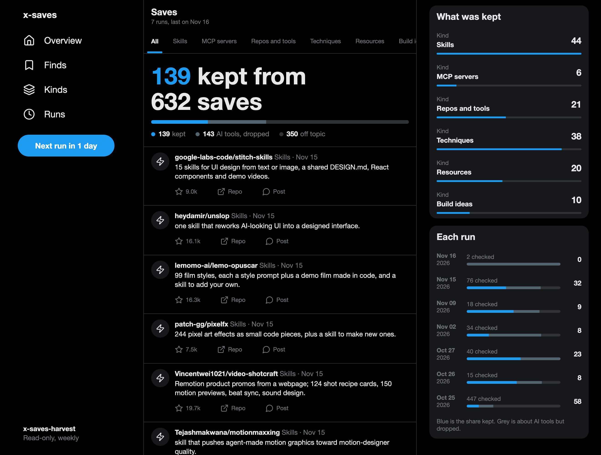

# x-saves-harvest

A Claude Code skill I run once a week. It goes through my X bookmarks and likes, keeps the new posts about AI tools, checks each linked GitHub repo, and adds what is worth keeping to a note. It only reads; it never likes, follows, replies or posts.

Built with Claude Code by Christopher Pond Maquidato, October 2026.



The dashboard, built from my own run history. `scripts/dashboard.py` writes it as one HTML file from the ledger and the note.

## What it does

1. **Collect.** Opens my bookmarks and likes in a browser tab I am already signed in to, scrolls in small steps and saves the posts. It stops at the end of the list or after 15 posts in a row it has already handled.
2. **Expand.** Drops handled posts, keeps the AI-related ones, fetches the full text, and checks every linked GitHub repo with `gh` (stars, last push, whether it holds skills).
3. **Judge.** Claude sorts each post into a kind (skill, MCP server, repo, technique, resource, build idea) or drops it.
4. **Write.** Adds one dated section to the note, newest first. Earlier runs are never rewritten.
5. **Mark handled.** Only after the note is saved, so a failed run loses nothing.
6. **Dashboard.** One page with every run, what was kept and the newest finds.

```
python3 scripts/dashboard.py --note ~/notes/"X Saves for Claude.md" --out dashboard.html
```

## What keeps it reliable

- **It checks the account first.** `--expect-account` stops the run if the browser is signed in to a different account.
- **It remembers what it handled.** Post ids are kept in `~/.local/state/x-saves-harvest/seen.json`, so each run shows only new saves and a rerun never doubles an entry.
- **It stops loudly.** If the tab is moved, or the list stops loading early, the script says so and keeps what it had.
- **It never signs in for me.** If the session has expired it asks me to sign in.

## What's here

| File | What it is |
|---|---|
| `SKILL.md` | What Claude reads: the steps, the sorting rules, the note format |
| `scripts/xsaves.py` | Collecting, expanding and the handled-posts ledger. Plain Python, no packages |
| `scripts/dashboard.py` | The one-page dashboard. Reads the ledger and the note, writes one HTML file |

## Dashboard design

X does not publish a design system, UI kit or component library for other people's products. I checked on Nov 22, 2026: its public resources are a brand toolkit, embeddable posts and timelines, and a few older open-source projects. So the page uses the two official things that exist and says where the rest comes from.

| Part | Source |
|---|---|
| Posts | **Official.** "Post" on a row opens X's own embedded post, dark theme, loaded from `platform.twitter.com/widgets.js` with `dnt` on. X draws it, so it follows X's display requirements |
| Black and white | **Official.** The X brand guide gives black `#000000` and white `#FFFFFF` as the primary colours |
| Typeface | Helvetica Neue first, the face the partner brand guide uses. X's own Chirp is not licensed for other products, so it is not used |
| Blue, greys, card colour | Not official. Read from x.com's dark theme: blue `#1d9bf0`, secondary text `#71767b`, lines `#2f3336`, cards `#16181c` |
| Layout | Not official. Modelled on X's home page: section links, a 600px timeline with kind tabs, a 350px column of cards |
| Icons | lucide. X's interface icons and logo are not used |

The page is not an X product and does not use the X logo. The only time the logo appears is inside X's own embed.

Sources: [X for Websites](https://docs.x.com/x-for-websites/overview), [display requirements](https://docs.x.com/developer-terms/display-requirements), [brand toolkit](https://about.x.com/en/who-we-are/brand-toolkit).

## Needs

- Claude Code, with this folder copied to `~/.claude/skills/x-saves-harvest/`.
- The Orca app, whose `orca` CLI drives the browser tab the collector reads, and the `gh` CLI for repo facts.
- Your own X handle for `--expect-account`, and your own notes path in step 5 of `SKILL.md`.
